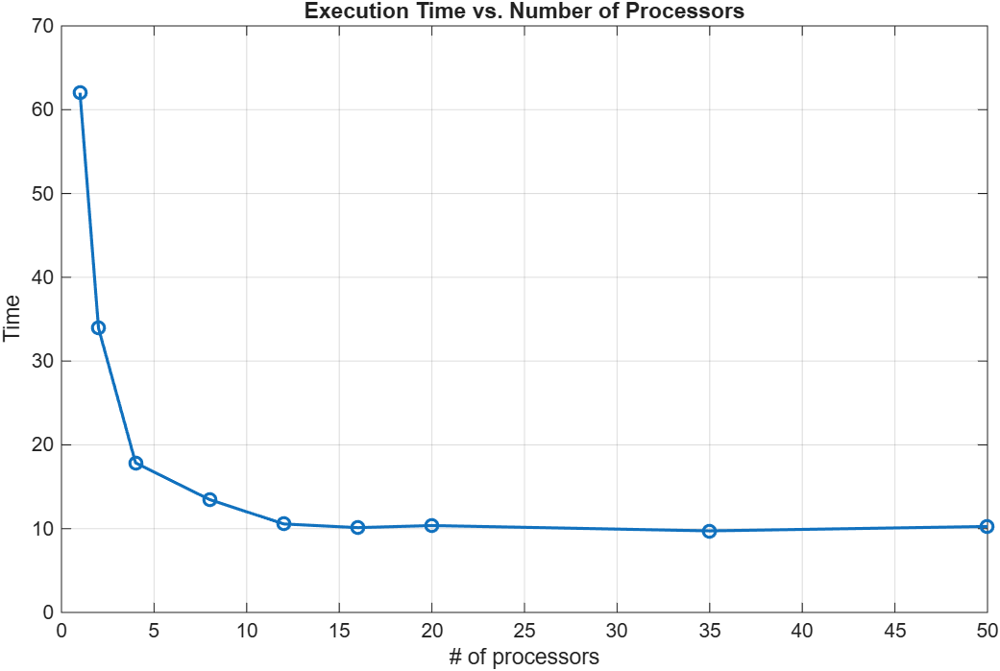

# mandel image creator

## Lab_11 Multiprocessing
mandel.c has been modified to use a specified number of processors to generate 50 images. The amount of processors is chosen by adding -n `<num_processors>` when calling the program in a terminal with the default being 1 processor if it is not specified. When the program is called for whatever number of processors is chosen that many children processes are created and they each are creating an image, one parent waits until 1 of the children finishes and then creates a new child to create the next image.

The graph shows that with a smaller amount of processors doubling the number of processor cuts the time to generate 50 images almost in half. However, there are a limited amount of processors on a computer and even though 50 processors can be entered as an argument there are only 14 processors on the computer used for testing. This causes the time it takes to generate 50 images to remain almost constant for any value above 12 chosen for the number of processors